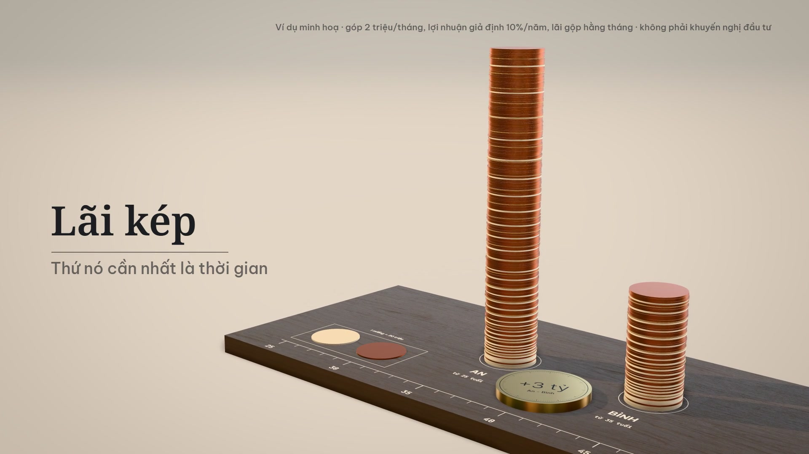

# VideoMaker: skill `video-ai` cho Claude Code

Sản xuất video ngắn **hoàn toàn bằng code**, có giọng đọc tiếng Việt, phụ đề, nhạc và tiếng động: đưa một yêu cầu, nhận về file MP4 thành phẩm.



Skill là lớp quy trình đặt trên thư viện style [lemo-opuscar](https://github.com/lemomo-ai/lemo-opuscar). Repo này **không** chứa lemo-opuscar; skill hướng dẫn agent clone thư viện về và dùng nó. Phần skill thêm vào:

- tiếng Việt: chuẩn hoá số và mã cổ phiếu, font, phụ đề;
- giọng ElevenLabs: tạo trên web hoặc qua API, căn thời gian từng từ, đặt câu lên lưới nhạc;
- chạy trên Windows;
- review, và các luật rút ra từ những lần làm thật.

> Trạng thái **v0.1**: đã làm trọn một phim. Đọc [ROADMAP.md](ROADMAP.md) trước khi dùng thật.

## Cài

```sh
git clone https://github.com/zeusato/VideoMaker.git ~/.claude/skills/video-ai
```

Sau đó làm theo [references/setup.md](references/setup.md): cài Node, Python, ffmpeg 7+, clone lemo-opuscar vào `<workspace>/vendor/lemo-opuscar`, cài core tier, sample library, HDRI.

Key ElevenLabs đặt trong biến `ELEVENLABS_API_KEY`, hoặc file `.env` ở thư mục dự án hay thư mục cha. Key cần quyền `text_to_speech` và `forced_alignment`. **Không commit file `.env`.**

## Dùng

Trong Claude Code, ở thư mục làm việc (workspace):

> làm video 45 giây giải thích lãi kép cho người mới đi làm, giọng ElevenLabs `<voice ID>`, gói Free

Agent đi theo [SKILL.md](SKILL.md):

1. Brief.
2. Chọn style.
3. Viết treatment.
4. Kịch bản có cue.
5. Làm giọng.
6. Dựng hình.
7. Làm âm thanh.
8. Build.
9. Review và một vòng sửa.
10. Giao file.

## Cấu trúc

```
SKILL.md                quy trình chính
references/             lemo-opuscar, giọng, tiếng Việt, cài đặt và tốc độ, review, chia việc, bài học
scripts/                normalize.mjs, lexicon.json, narration.mjs, voice.mjs, eleven.mjs, fonts.mjs, export.mjs
templates/              script.json, timeline.js, voice-brief.md, build.sh, TREATMENT.md, FACTS.md
examples/lai-kep/       phim mẫu (mã nguồn, không có audio/video): Data Physicalization, 43 giây
ROADMAP.md              việc cần làm trước khi dùng thật
```

## Ví dụ: `examples/lai-kep`

"Lãi kép": hai người cùng góp 2 triệu/tháng, một người bắt đầu sớm hơn 10 năm. Mỗi miếng là 20 triệu: gỗ sồi là tiền tự góp, xu đồng là tiền lãi. Năm 37 tuổi 9 tháng, đồng vượt gỗ. Đến 55 tuổi: 4,52 tỷ so với 1,52 tỷ. Số liệu là ví dụ minh hoạ tính theo công thức ([FACTS.md](examples/lai-kep/FACTS.md)), không phải khuyến nghị đầu tư.

Dựng lại (cần `audio/full.mp3` thu từ `narration.txt`):

```sh
cd <workspace>/films && cp -r ~/.claude/skills/video-ai/examples/lai-kep . && sh lai-kep/build.sh
```

## Giấy phép tài nguyên

- lemo-opuscar: MIT (code), CC BY 4.0 (phim demo của họ).
- Font: OFL.
- Mẫu nhạc cụ và HDRI: CC0.
- Chi tiết ở [examples/lai-kep/CREDITS](examples/lai-kep/CREDITS).
